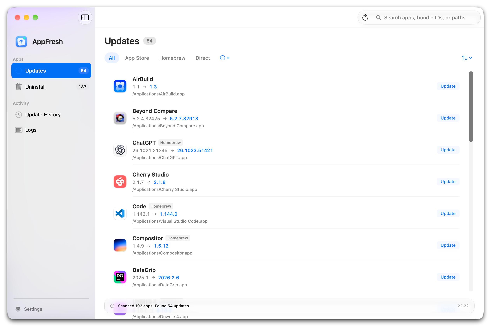

[English](README.md) | [中文](README_ZH.md)

# AppFresh


## 好应用，常用常新

AppFresh 让 Mac 应用的日常管理变得轻松。集中检查来自 App Store、Homebrew 和开发者官网的更新，查看版本变化，卸载不再需要的应用并清理关联文件。让常用的保持新鲜，让不用的轻松退场。

[](https://github.com/AppFresh/AppFresh/stargazers)
[](https://github.com/AppFresh/AppFresh/releases)
[](LICENSE)
[](https://AppFresh.app)

## ✨ 关于 AppFresh

AppFresh 是本机 Mac 应用管理工具：集中扫描已安装应用，统一检查来自 App Store、Homebrew 和开发者官网三种来源的更新，并支持卸载应用及清理关联文件。界面支持简体中文与英语。

## 📸 界面预览



## 🚀 功能特性

### 🔎 集中检查更新
集中扫描已安装应用，统一查询 App Store、Homebrew 与开发者官网三种来源，一处查看所有可用更新与版本变化。

### ⚡ 一键更新
按来源采用对应更新方式：App Store 经内置 mas、Homebrew 经 brew、官网包经校验后替换安装；应用自身也通过 Sparkle 自动检查更新。

### 🧹 卸载与清理
卸载不再需要的应用，并一并清理缓存、偏好设置、容器等关联文件；浏览器资料、聊天记录等敏感数据默认保留，由你确认后再删除。

### 🧭 管理已安装应用
在一个界面查看本机所有已安装应用，按来源筛选，按名称、大小、最近使用或安装日期排序，随时查看版本、大小与安装来源。

## 🤔 为什么选择 AppFresh

macOS 应用的更新分散在 App Store、Homebrew 和各个开发者官网，逐一检查既麻烦又容易遗漏；不再需要的应用还会留下缓存与偏好设置等残留。AppFresh 把它们集中到一处，并补上卸载清理，让常用的保持新鲜，不用的轻松退场。

## ⚙️ 安装

### 下载

从 GitHub Releases 获取最新版本（DMG / ZIP）：

```
https://github.com/AppFresh/AppFresh/releases
```

或访问官网：

```
https://AppFresh.app
```

安装后，AppFresh 会通过 Sparkle 自动检查并提示自身更新。

## 🖥 系统要求

- macOS 14 或更新
- Apple Silicon（arm64）
- 界面支持简体中文与英语

## ⭐ 支持项目

如果你觉得 AppFresh 有用：

⭐ **给项目点个 Star**

这能帮助更多开发者发现它。

## 🔗 相关链接

Website: https://AppFresh.app  
Releases: https://github.com/AppFresh/AppFresh/releases
